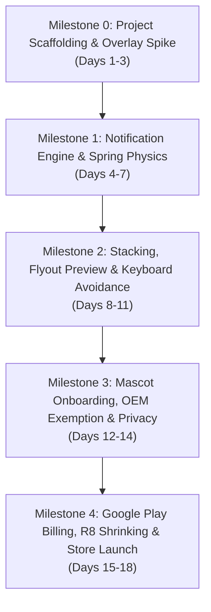

# Implementation Roadmap & Milestone Schedule: Notification Bubble App

> **Objective**: Phased delivery schedule, milestone criteria, dependency mapping, and risk mitigation register for MVP v1.0.  
> **Skill Activated**: `roadmap-and-milestones` ([SKILL.md](file:///Users/ahmadnazar/Documents/GitHub/notification-bubble-app/ai-skills/01-app-development/02-planning-and-pm/roadmap-and-milestones/SKILL.md))  
> **Target Release**: v1.0 Production Release on Google Play  
> **Date**: 2026-11-21  

---

## 1. Roadmap Architecture & Phase Dependencies

---

## 2. Detailed Milestone Specifications

### Milestone 0: Foundation, Tooling & Overlay Spike
* **Focus**: Establish the native Android build pipeline, Jetpack Compose overlay window, and basic on-screen draggable circle.
* **Duration**: Days 1–3
* **Deliverables**:
  1. Root Gradle setup (`build.gradle.kts`, `settings.gradle.kts`, Compose BOM pinned).
  2. `AndroidManifest.xml` configured with `SYSTEM_ALERT_WINDOW` and zero internet permissions.
  3. `OverlayService`: Background Android Service creating a hardware-accelerated full-screen transparent window.
  4. Static 56dp circular bubble rendered on screen that can be dragged freely.
* **Exit Gate / DoD**:
  - [ ] App compiles and runs on an Android 13/14 physical device or emulator.
  - [ ] Floating bubble renders over home screen and third-party apps without crashing.

---

### Milestone 1: Notification Ingestion & Tactile Spring Physics
* **Focus**: Connect the OS notification stream to the floating bubble with organic Messenger-style spring motion and dismiss targets.
* **Duration**: Days 4–7
* **Deliverables**:
  1. `NotificationListenerService`: Intercepts incoming notifications from approved test chat apps (e.g. WhatsApp, Telegram, SMS).
  2. `BubblePhysicsController`: Damped spring physics snapping (`StiffnessMediumLow`, `DampingRatioLowBouncy`) with recoil.
  3. Strict `16dp` edge margin to guarantee Android back-navigation gestures remain unobstructed.
  4. Bottom-center magnetic dismiss target ("Black Hole"): 100dp attraction radius with haptic feedback.
* **Exit Gate / DoD**:
  - [ ] Incoming text notification automatically triggers a bubble spawn.
  - [ ] Bubble snaps smoothly to left/right screen edges with realistic bounce.
  - [ ] Dragging bubble to bottom dismiss target removes it from the screen.

---

### Milestone 2: Multi-App Stacking, Flyout Card & Keyboard Avoidance
* **Focus**: Multi-conversation management, preview expansion, inline quick reply, and keyboard collision prevention.
* **Duration**: Days 8–11
* **Deliverables**:
  1. Multi-head stacking algorithm: Up to 3 conversation heads rendered with a 12dp stagger.
  2. Expanded Mini-Flyout Card: 2-line sender/message snippet with `[Reply]`, `[Mark Read]`, and `[Dismiss]` pills.
  3. Inline quick-reply input field supporting Android `RemoteInput` action intents.
  4. `WindowInsets.Type.ime()` sensor: Automatically translates active bubbles and flyout cards upward above the keyboard.
  5. Landscape / Full-screen auto-dock: Automatically collapses bubbles into a 40% opacity side-pill during landscape orientation.
* **Exit Gate / DoD**:
  - [ ] Tapping bubble expands preview card without opening full messaging app.
  - [ ] Opening virtual keyboard shifts bubble upward; zero blocked keystrokes.
  - [ ] Rotating phone to landscape collapses bubble to unobtrusive side-tab.

---

### Milestone 3: Mascot Onboarding, OEM Whitelist & Sensitive Data Privacy
* **Focus**: Onboarding conversion, preventing background kills on Samsung/Xiaomi, and protecting sensitive OTP codes.
* **Duration**: Days 12–14
* **Deliverables**:
  1. Onboarding UI featuring the **"Bubby / Pebble"** mascot to guide users through Overlay & Notification permissions.
  2. Integrated OEM Battery Optimization Wizard (`dontkillmyapp.com` deep-links for Samsung, Xiaomi, OnePlus).
  3. App Picker: 0 apps selected by default + 1-tap `[Chats Only]` preset.
  4. Sensitive data filter: Automatically regex-masks 2FA codes, OTPs, and banking alerts (`"••••••"`).
  5. Room SQLite Database: Local storage for user app whitelist and per-app preferences.
* **Exit Gate / DoD**:
  - [ ] Onboarding wizard successfully opens exact OEM battery exemption screens.
  - [ ] Bank OTP notifications appear with masked text until tapped.
  - [ ] Background service survives 24-hour Doze mode without dying on a real phone.

---

### Milestone 4: Monetization, R8 Shrinking & Google Play Release
* **Focus**: In-App Billing v6 integration, APK size reduction under 5MB, and Google Play Store submission.
* **Duration**: Days 15–18
* **Deliverables**:
  1. Google Play Billing Library v6+ integration for the **$3.99 Lifetime Pro License**.
  2. Pro feature gates: Unlimited apps, Dark OLED Black, and Frosted Glass themes.
  3. Offline purchase token caching in Room with 1-tap `[Restore Purchase]`.
  4. R8 ProGuard full optimization (`isMinifyEnabled = true`, `isShrinkResources = true`).
  5. Play Store assets: High-res mascot icon, ASO-optimized listing copy, and feature screenshots.
* **Exit Gate / DoD**:
  - [ ] Final release AAB download size verified under **5.0 MB**.
  - [ ] Test purchase and license restoration pass Google Play License Testing.
  - [ ] Signed release bundle uploaded to Google Play Internal Testing track.

---

## 3. Risk Assessment & Mitigation Register

| Risk ID | Risk Category | Severity | Probability | Risk Description | Planned Mitigation Strategy |
|:---:|---|:---:|:---:|---|---|
| **R-01** | **Platform / OS** | **High** | High | Aggressive OEM task killers (Samsung One UI, Xiaomi HyperOS) kill the notification listener. | Foreground service with low-priority notification + OEM setup wizard deep-linking to autostart settings. |
| **R-02** | **UX / Interaction**| **High** | Medium | Overlays conflict with system navigation edge gestures or virtual keyboards. | Enforce 16dp edge inset padding; listen to `WindowInsets.Type.ime()` to auto-shift coordinates. |
| **R-03** | **Performance** | **Medium**| Low | Drag animation drops frames or lags on 120Hz high-refresh displays. | Pure Jetpack Compose GPU hardware acceleration via `graphicsLayer` transforms; zero memory allocations in touch loops. |
| **R-04** | **Google Policy** | **High** | Low | Google Play flags `BIND_NOTIFICATION_LISTENER_SERVICE` as potential spyware. | Omit `INTERNET` permission entirely from the manifest, mathematically guaranteeing zero external data leak. |
| **R-05** | **Binary Size** | **Medium**| Low | Transitive Android library dependencies push download size over 10MB. | Vector drawables only; Coil image loader (~150KB); full R8 dead-code and resource stripping. |

---

## 4. Definition of Done (DoD) for v1.0 Launch

The MVP is considered **shipped and successful** when all of the following conditions are met:
1. **Zero-Lag Overlay**: Bubble drags at a steady 90Hz/120Hz on modern Android devices without stutter.
2. **24-Hour Uptime**: The background service survives overnight screen sleep on Samsung and Xiaomi without missing alerts.
3. **Download Size Under 5MB**: The compiled release Android App Bundle (`.aab`) downloads in under 3 seconds.
4. **Zero-Network Verified**: No socket connections or HTTP traffic can be initiated from the app.
5. **Google Play Approved**: Published to Production with in-app purchase active.
