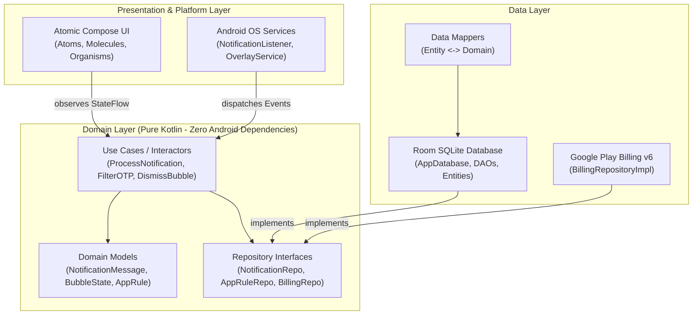

# Clean Architecture Specification: Notification Bubble App

> **Objective**: Enforce strict layer boundaries, dependency inversion, and Unidirectional Data Flow (UDF) to ensure 100% modular, testable, and maintainable native Android code.  
> **Skill Activated**: `clean-architecture-enforcer` ([SKILL.md](file:///Users/ahmadnazar/Documents/GitHub/notification-bubble-app/ai-skills/01-app-development/03-architecture-and-tech/clean-architecture-enforcer/SKILL.md))  
> **Target Package**: `com.notificationbubble.app`  
> **Date**: 2026-11-22  

---

## 1. Architectural Core Principles



### The Invariant Dependency Law
* **The Golden Rule**: Dependencies point strictly **inward**. Inner layers know nothing about outer layers.
* **Domain Layer Isolation**: The `domain/` package contains **pure Kotlin only**. Importing any `android.*` class (e.g. `android.content.Context`, `android.view.View`, `android.app.Notification`) in `domain/` is **strictly forbidden**.
* **Zero UI-to-Database Coupling**: The Jetpack Compose UI never accesses Room DAOs or SQLite directly. It only observes immutable `StateFlow` streams exposed by Use Cases.

---

## 2. Layer-by-Layer Architecture

### A. Domain Layer (`com.notificationbubble.app.domain`)
*The heart of the application; completely decoupled from Android framework APIs.*

* **Models** (`domain.model`):
  * `NotificationMessage`: Represents an incoming message (`id`, `senderName`, `textSnippet`, `appPackage`, `timestamp`, `isMasked`, `replyActionIntent`).
  * `ActiveBubble`: Represents a single floating bubble on screen (`conversationId`, `senderName`, `avatarUri`, `unreadCount`, `screenCoordinates`).
  * `BubbleStackState`: Immutable state containing the list of active bubbles, currently selected head, and overlay visibility state (`DockedSidePill`, `FloatingActive`, `ExpandedPreview`).
  * `AppRule`: Whitelist state for an installed app (`packageName`, `appName`, `isWhitelisted`, `isCustomRule`).
* **Repository Interfaces** (`domain.repository`):
  * `NotificationRepository`: `observeActiveQueue(): Flow<List<NotificationMessage>>`, `enqueueNotification(...)`, `dismissNotification(id)`.
  * `AppRuleRepository`: `observeWhitelistedApps(): Flow<List<AppRule>>`, `setAppWhitelistStatus(pkg, Boolean)`.
  * `BillingRepository`: `observeProStatus(): Flow<Boolean>`, `restorePurchases()`.
* **Use Cases** (`domain.usecase`):
  * `ProcessIncomingNotificationUseCase`: Validates incoming alerts against app whitelists and filters out silent/media spam.
  * `FilterSensitiveContentUseCase`: Regex-checks banking/OTP tokens and applies `"••••••"` masks.
  * `DismissBubbleUseCase`: Removes a conversation from the active queue and clears OS status tray alerts.
  * `GetActiveBubbleStackUseCase`: Computes staggered coordinates for up to 3 active conversation heads.

---

### B. Data Layer (`com.notificationbubble.app.data`)
*Implements repository interfaces using local persistence and OS hardware APIs.*

* **Local Room Database** (`data.local`):
  * `AppDatabase`: Abstract Room database subclass with schema versioning.
  * `AppRuleEntity` & `AppRuleDao`: Stores persistent app whitelist toggles.
  * `PurchaseEntity` & `PurchaseDao`: Caches offline Google Play billing tokens.
* **Mappers** (`data.mapper`):
  * `AppRuleMapper`: Transforms `AppRuleEntity` (database representation) into `AppRule` (domain model) and vice-versa.
* **Billing Implementation** (`data.billing`):
  * `BillingRepositoryImpl`: Wraps Google Play `BillingClient` v6, handles purchase state, and persists Pro lifetime unlock.

---

### C. Presentation & Platform Layer (`com.notificationbubble.app.service` & `ui`)
*Handles Android OS interactions, WindowManager rendering, and Compose UI.*

* **Platform Services** (`service`):
  * `NotificationListener`: Listens to `StatusBarNotification` events, extracts payload, and delegates immediately to `ProcessIncomingNotificationUseCase`.
  * `OverlayService`: Background Foreground Service holding the `SYSTEM_ALERT_WINDOW` and rendering the Compose root.
* **Atomic UI Hierarchy** (`ui`):
  * `ui.theme`: Design tokens (`Color.kt`, `Type.kt`, `Dimensions.kt`, `BubbleTheme.kt`).
  * `ui.atoms`: Visual primitives with zero business logic (`AvatarCircle`, `AppBadgeIcon`, `ActionPill`, `UnreadCounterBadge`).
  * `ui.molecules`: Self-contained interactive components (`FloatingBubbleItem`, `QuickReplyInput`, `ExpandedFlyoutCard`).
  * `ui.organisms`: Composed screen structures (`ActiveBubbleStack`, `DismissTargetZone`).

---

## 3. Unidirectional Data Flow (UDF) Loop

The app operates on a strict cyclical state machine:

```
    ┌────────────────────────────────────────────────────────┐
    │ 1. State: Compose UI renders current BubbleOverlayState│
    └───────────────────────────┬────────────────────────────┘
                                │
                                ▼
    ┌────────────────────────────────────────────────────────┐
    │ 2. Event: User drags bubble / OS notification arrives  │
    └───────────────────────────┬────────────────────────────┘
                                │
                                ▼
    ┌────────────────────────────────────────────────────────┐
    │ 3. Dispatch: Event forwarded to relevant Use Case      │
    └───────────────────────────┬────────────────────────────┘
                                │
                                ▼
    ┌────────────────────────────────────────────────────────┐
    │ 4. Mutation: Use Case updates Repository (Room/RAM)    │
    └───────────────────────────┬────────────────────────────┘
                                │
                                ▼
    ┌────────────────────────────────────────────────────────┐
    │ 5. Emission: Repository emits new immutable StateFlow  │
    └───────────────────────────┬────────────────────────────┘
                                │
                                └───────── (Cycle Repeats)
```

---

## 4. Compiler & Linter Verification Rules

To prevent architectural decay over time, our Gradle build and Lint rules will enforce:

1. **No `android.*` in `domain/`**: Any PR or commit attempting to import Android SDK classes into `domain/` fails lint checks automatically.
2. **Repository Interfaces in `domain/`, Implementations in `data/`**: Use cases never reference `*Impl` classes or `AppDatabase`.
3. **State Immutability**: All domain models and UI states are declared as Kotlin `data class` with immutable `val` properties only.

---

## 5. Next Steps for Step 3.2

With layer boundaries and data contracts locked down:
- In **Step 3.2 (`tech-and-library-selector`)**, we pin the exact Gradle plugin versions, Compose BOM, Room SQLite compiler (KSP), and Coil libraries.
