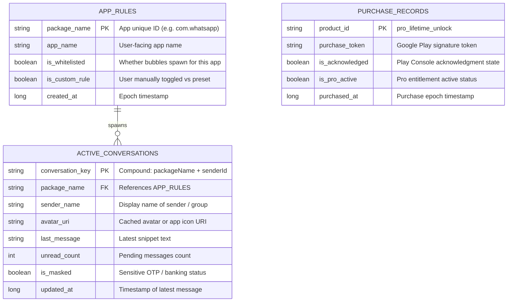

# Data Modeling & Room Database Schema: Notification Bubble App

> **Objective**: Local SQLite data architecture, Room `@Entity` definitions, sub-millisecond indexing strategies, and repository data contracts.  
> **Skill Activated**: `api-and-data-modeling` ([SKILL.md](file:///Users/ahmadnazar/Documents/GitHub/notification-bubble-app/ai-skills/01-app-development/03-architecture-and-tech/api-and-data-modeling/SKILL.md))  
> **Target Database**: `AppDatabase` (SQLite via Android Room 2.6.1 + KSP)  
> **Date**: 2026-11-22  

---

## 1. Executive Summary & Access Patterns

The Notification Bubble App requires an ultra-fast, local-only data layer optimized for:
1. **Sub-Millisecond Whitelist Checks**: When Android fires `onNotificationPosted()`, the database must determine whether the source package is approved in $< 1\text{ ms}$ to avoid blocking the OS notification thread.
2. **Ephemeral Conversation Queues**: Active bubble conversations are kept in local SQLite for state survival across phone restarts, but automatically pruned on dismiss.
3. **Offline Billing Cache**: Google Play Pro purchase tokens are stored locally so Pro features unlock instantaneously without requiring internet checks.

---

## 2. Entity-Relationship Diagram (ERD)



---

## 3. Physical Schema & Room Entity Definitions

### A. Table: `app_rules`
Stores the whitelist status of installed apps.

```kotlin
@Entity(
    tableName = "app_rules",
    indices = [
        Index(value = ["is_whitelisted"]) // Fast query for whitelist filtering
    ]
)
data class AppRuleEntity(
    @PrimaryKey
    @ColumnInfo(name = "package_name")
    val packageName: String,

    @ColumnInfo(name = "app_name")
    val appName: String,

    @ColumnInfo(name = "is_whitelisted")
    val isWhitelisted: Boolean = false,

    @ColumnInfo(name = "is_custom_rule")
    val isCustomRule: Boolean = false,

    @ColumnInfo(name = "created_at")
    val createdAt: Long = System.currentTimeMillis()
)
```

### B. Table: `active_conversations`
Tracks active bubbles currently rendered on the user's screen.

```kotlin
@Entity(
    tableName = "active_conversations",
    foreignKeys = [
        ForeignKey(
            entity = AppRuleEntity::class,
            parentColumns = ["package_name"],
            childColumns = ["package_name"],
            onDelete = ForeignKey.CASCADE
        )
    ],
    indices = [
        Index(value = ["package_name"]),
        Index(value = ["updated_at"]) // Fast sorting for top active head
    ]
)
data class ActiveConversationEntity(
    @PrimaryKey
    @ColumnInfo(name = "conversation_key")
    val conversationKey: String, // e.g. "com.whatsapp:JohnDoe"

    @ColumnInfo(name = "package_name")
    val packageName: String,

    @ColumnInfo(name = "sender_name")
    val senderName: String,

    @ColumnInfo(name = "avatar_uri")
    val avatarUri: String?,

    @ColumnInfo(name = "last_message")
    val lastMessage: String,

    @ColumnInfo(name = "unread_count")
    val unreadCount: Int = 1,

    @ColumnInfo(name = "is_masked")
    val isMasked: Boolean = false,

    @ColumnInfo(name = "updated_at")
    val updatedAt: Long = System.currentTimeMillis()
)
```

### C. Table: `purchase_records`
Stores offline entitlement for the Pro Lifetime Unlock.

```kotlin
@Entity(tableName = "purchase_records")
data class PurchaseEntity(
    @PrimaryKey
    @ColumnInfo(name = "product_id")
    val productId: String, // "pro_lifetime_unlock"

    @ColumnInfo(name = "purchase_token")
    val purchaseToken: String,

    @ColumnInfo(name = "is_acknowledged")
    val isAcknowledged: Boolean = false,

    @ColumnInfo(name = "is_pro_active")
    val isProActive: Boolean = false,

    @ColumnInfo(name = "purchased_at")
    val purchasedAt: Long = System.currentTimeMillis()
)
```

---

## 4. Data Access Object (DAO) Contracts

All queries return reactive Kotlin `Flow<T>` streams to drive Jetpack Compose UDF state machines:

### `AppRuleDao`
```kotlin
@Dao
interface AppRuleDao {
    @Query("SELECT * FROM app_rules ORDER BY app_name ASC")
    fun observeAllRules(): Flow<List<AppRuleEntity>>

    @Query("SELECT is_whitelisted FROM app_rules WHERE package_name = :pkg LIMIT 1")
    suspend fun isAppWhitelisted(pkg: String): Boolean?

    @Insert(onConflict = OnConflictStrategy.REPLACE)
    suspend fun upsertRule(rule: AppRuleEntity)

    @Insert(onConflict = OnConflictStrategy.IGNORE)
    suspend fun insertDefaults(rules: List<AppRuleEntity>)

    @Query("UPDATE app_rules SET is_whitelisted = :whitelisted WHERE package_name = :pkg")
    suspend fun updateWhitelistStatus(pkg: String, whitelisted: Boolean)
}
```

### `ActiveConversationDao`
```kotlin
@Dao
interface ActiveConversationDao {
    @Query("SELECT * FROM active_conversations ORDER BY updated_at DESC")
    fun observeActiveQueue(): Flow<List<ActiveConversationEntity>>

    @Insert(onConflict = OnConflictStrategy.REPLACE)
    suspend fun upsertConversation(conversation: ActiveConversationEntity)

    @Query("DELETE FROM active_conversations WHERE conversation_key = :key")
    suspend fun dismissConversation(key: String)

    @Query("DELETE FROM active_conversations")
    suspend fun clearAll()

    // Prune stale conversations older than 24 hours
    @Query("DELETE FROM active_conversations WHERE updated_at < :threshold")
    suspend fun pruneStaleConversations(threshold: Long)
}
```

---

## 5. Clean Architecture Data Mappers

To uphold Clean Architecture, entities are never exposed to the UI or Domain layer. Mappers convert them seamlessly:

```kotlin
fun AppRuleEntity.toDomain() = AppRule(
    packageName = this.packageName,
    appName = this.appName,
    isWhitelisted = this.isWhitelisted,
    isCustomRule = this.isCustomRule
)

fun ActiveConversationEntity.toDomain() = NotificationMessage(
    id = this.conversationKey,
    packageName = this.packageName,
    senderName = this.senderName,
    avatarUri = this.avatarUri,
    textSnippet = this.lastMessage,
    unreadCount = this.unreadCount,
    isMasked = this.isMasked,
    timestamp = this.updatedAt
)
```

---

## 6. Actionable Takeaways for Step 3.5

- In **Step 3.5 (`security-and-privacy-audit`)**, we perform the pre-implementation security and privacy gate check, verifying that sensitive OTP codes are redacted and zero network sockets exist in the codebase.
